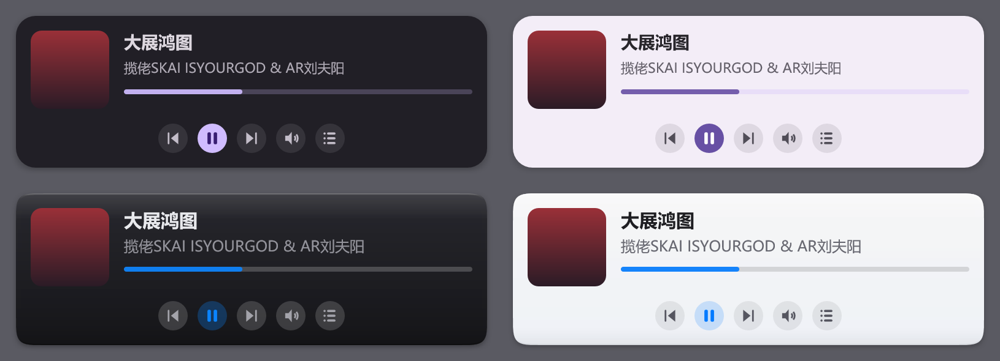
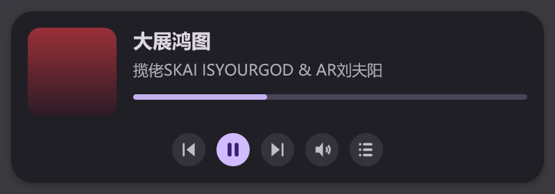
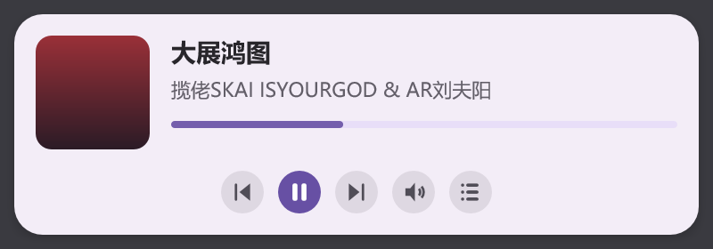
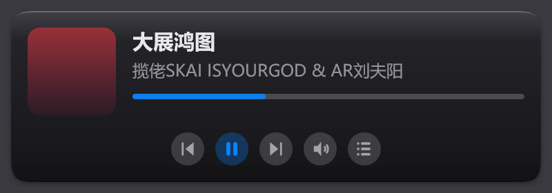
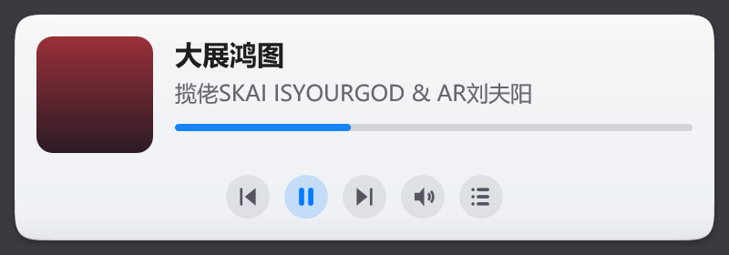
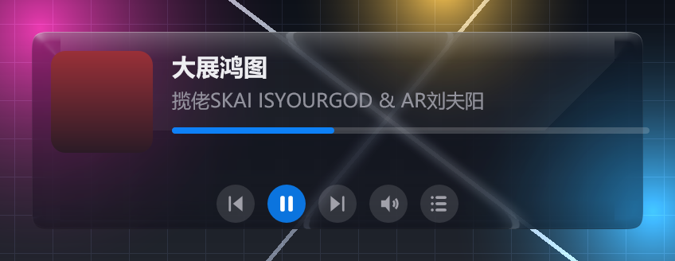
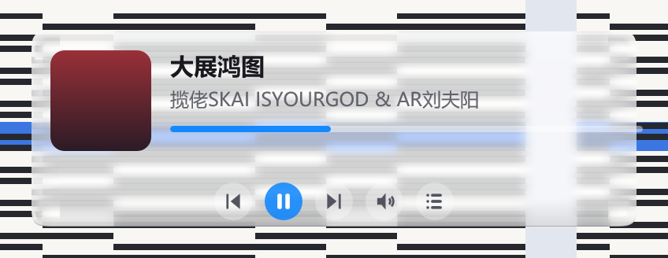
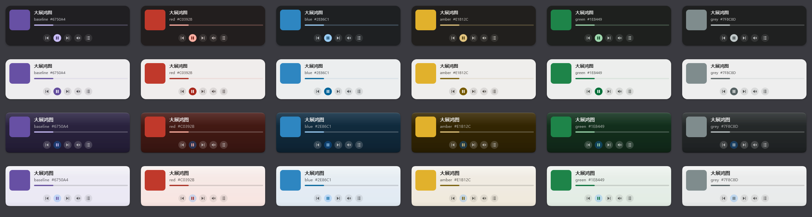
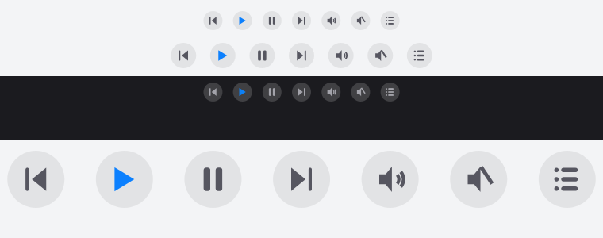

# floating clouds - foobar2000 plugus
**Language**: **ENGLISH** | [简体中文](README_CN.md)
***
Foobar2000 SDK Version: SDK-2025-03-07
Windows Template Library: WTL10_01_Release
***

A foobar2000 component that shows a floating now-playing overlay on the desktop or over fullscreen games. It displays album art, track title, artist, and playback controls.



## Components

This repository contains three independent foobar2000 components:

| Component | DLL | What it does |
| --- | --- | --- |
| **Floating Clouds** | `foo_floating_clouds.dll` | The floating now-playing overlay described below |
| **Playlist Organizer** | `foo_playlist_organizer.dll` | Groups an active playlist by album artist into locked, A-Z sorted per-artist playlists. [README](floating_clouds_organizing_playlists/README.md) |
| **Apple Music Tags** | `foo_floating_clouds_tags.dll` | Fetches Apple Music tags per region and writes them to selected tracks. [README](floating_clouds_tags/README.md) |

## Features

- Floating overlay: an independent topmost window above the desktop or fullscreen games
- 7 styles: Minimal, Full, Album Focus, Progress Ring, Visualizer, Lyrics Line, Visualizer + Cover
- 3 materials (skins): **Material 3** and **Mist** with dark and light palettes, plus **Liquid Glass**, which has a single appearance because its colour comes from the desktop behind it
- 4 colour modes: follow foobar2000, force dark, force light, or **Album (cover colour)** — the scheme's hue is taken from the current album cover
- Vector control icons: one weight for the whole row, state-aware (play shows Pause while playing), drawn as paths instead of font glyphs so they never shift with the UI font
- Font family: follows foobar2000's default UI font, or pick any installed family from the dropdown in Preferences
- Per-pixel alpha rendering: UpdateLayeredWindow path (driver agnostic, avoids AMD DirectComposition flicker) with a uniform alpha fallback
- Smooth 60fps animation: frame rate independent easing for progress, fades, button state layers, and show/hide
- Customizable global hotkeys: drag mode, show/hide, cycle styles, cycle skins
- Click-through: buttons receive clicks, other areas pass through; drag mode moves the window
- System tray: right-click menu for styles, skins, and visibility
- Playlist picker: opens a three-level panel (playlists, albums, tracks)
- Lyrics: embedded LRC or plain text, synced to playback
- Real-time visualizer: smoothed FFT spectrum bars
- Preferences page: hotkeys, opacity, default style, skin, colour mode, font family, auto-hide, UI language, debug logging

## Quick Start

1. Download the latest release from [Releases](https://github.com/Coconutat/floating-clouds---foobar2000-plugus/releases)
2. Install `foo_floating_clouds.fb2k-component`, or copy `foo_floating_clouds.dll` into your foobar2000 `components` directory
3. Restart foobar2000. The floating window appears automatically.
4. Default hotkeys: `Ctrl+Alt+D` toggles drag mode, `Ctrl+Alt+F` hide/show, `Ctrl+Alt+S` cycles styles, `Ctrl+Alt+T` cycles skins

> All hotkeys can be customized in `File > Preferences > Components > Floating Clouds`: click a
> hotkey box, then press the new key combination (must include Ctrl/Alt/Shift/Win).

## Screenshots

The previews are rendered at 2x from the component's own painter (same tokens, corner geometry
and icons as the shipped build), so they match the real window geometry rather than approximating it.
They are reproducible: run `tools\preview\build_preview.cmd` and then `preview.exe` from the repository
root (no foobar2000 SDK required) to regenerate the Material 3 and Mist cards and the hero grid. The
two Liquid Glass cards come from the material probe instead, which renders the lens over synthetic
backdrops (a dark game scene and a bright document) because the lens needs a captured backdrop.

<table>
  <tr>
    <td align="center"><br/><b>Material 3 · dark</b></td>
    <td align="center"><br/><b>Material 3 · light</b></td>
  </tr>
  <tr>
    <td align="center"><br/><b>Mist · dark</b></td>
    <td align="center"><br/><b>Mist · light</b></td>
  </tr>
  <tr>
    <td align="center"><br/><b>Liquid Glass · over a dark backdrop</b></td>
    <td align="center"><br/><b>Liquid Glass · over a bright backdrop</b></td>
  </tr>
</table>

**Album colour.** With `Album (cover colour)` the whole scheme follows the playing cover: rows 1–2 are
Material 3 dynamic schemes, rows 3–4 are Mist with the frosted panel itself tinted, six cover seeds
(purple, red, blue, amber, green, grey).



**Control icons** at real size (24px and 32px buttons) and magnified:



## Styles

| Style | Description |
| --- | --- |
| Minimal | Single line: play icon, title and artist, thin bottom progress bar. Low obstruction, good for fullscreen games. |
| Full | Small album art, title/artist, progress bar, control buttons |
| Album Focus | Large album art as the hero visual, info and controls below |
| Progress Ring | Thumbnail surrounded by a circular progress ring |
| Visualizer | Real-time FFT spectrum bars plus track info, game HUD style |
| Lyrics Line | Current synced lyric line, visible at a glance during games |
| Visualizer + Cover | Album art and track info above the spectrum, with a wave-base progress line below. An option attaches the line to the wave baseline and matches its width to the bars. |

The previews above show the **Full** style; every style uses the same material and colour system.

## Materials (skins)

| Skin | Description |
| --- | --- |
| **Material 3** | Tonal surface card: surface-container fill, rounded corners, elevation shadow, MD3 type ramp. The active control is a filled icon button (`primary` fill + `on-primary` glyph) and the progress track is `secondary-container`. |
| **Mist** | Frosted floating panel: near-opaque body with a shallow vertical gradient, a 1px inner rim that is bright at the top edge and shaded at the bottom, a specular top highlight, continuous ("squircle") corners, and a two-layer shadow fitted inside the window margin. |
| **Liquid Glass** | The one material that is not a fill: the desktop behind the window is captured, blurred, and refracted by a lens band at the edge (18px band, 11px bend, ~1px chromatic dispersion), then tinted and lit. Text stays readable through **vibrancy**: the material measures the backdrop and flips polarity — dark glass with white ink over a dark desktop (9.2:1), light glass with dark ink over a bright one (10.4:1). Falls back to the static frosted recipe where the backdrop cannot be sampled. |

Material 3 and Mist never claimed to be backdrop-blur glass, and are not: they are honest frosted
panels. Liquid Glass *does* sample the backdrop, which is only possible because the window excludes
itself from screen capture (`SetWindowDisplayAffinity(..., WDA_EXCLUDEFROMCAPTURE)`) and a worker
thread copies the desktop behind it. **While Liquid Glass is the active skin, the overlay is therefore
invisible to screenshots, recordings and screen sharing** (Snipping Tool, OBS, Teams/Zoom,
Windows.Graphics.Capture). Switching to Material 3 or Mist restores normal capture immediately.

## Colour modes

| Mode | What it does |
| --- | --- |
| Follow foobar2000 | Uses foobar2000's dark/light setting (default) |
| Dark / Light | Forces the appearance |
| **Album (cover colour)** | Derives the scheme's hue from the current album cover. Material 3 gets a full dynamic scheme; Mist gets a tinted panel with the same structure. Liquid Glass ignores it: that material's colour is whatever is behind the window, so tinting it from the cover would be a second, contradictory source. Light/dark still follows foobar2000, because the cover supplies the hue, not the appearance. |

How album colour stays readable: the cover only supplies a **hue**. Every role is then placed at its
Material 3 **tone** (a fixed lightness) with a chroma budget that shrinks toward black and white, so
`primary`/`on-primary`, `surface`/`on-surface` and the rest keep their contrast whatever the cover
looks like. A cover with no usable hue falls back to the MD3 baseline purple. Measured across six
covers: body text 12.7–14.8:1, accent on surface 5.3–9.9:1, filled-button pair 6.1–7.8:1; the Mist
tinted panel 11.4–12.1:1 (dark) and 16.2:1 (light).

The font family follows foobar2000's default UI font, or pick any installed family from the dropdown
in Preferences ("(Follow foobar2000)" is the first entry).

## Requirements

- foobar2000 v2.0 or later (Windows 10 64-bit)
- Liquid Glass additionally needs **Windows 10 version 2004 (build 19041) or later** for backdrop
  capture; on older builds, and in exclusive-fullscreen games, that skin falls back to its static
  frosted recipe automatically

## Build

Requires Visual Studio 2019+ with C++17 support and the foobar2000 SDK.

The foobar2000 SDK is **not bundled** with this repository. Download the matching SDK version (2025-03-07) from <https://www.foobar2000.org/SDK> and extract it into an `SDK/` folder at the repository root. The project files reference `..\\SDK\\...` paths. Use it under its own license (`SDK/sdk-license.txt`).

The root `build.ps1` builds all three components in one run and collects the packages into the root `dist/` folder.

### Release artifacts

Packaging names every install file after its component, version and build date:

```
<component>-<version>-<yyyyMMdd>.fb2k-component
foo_floating_clouds-0.2.5-20261107.fb2k-component
foo_floating_clouds_tags-0.2.5-20261107.fb2k-component
foo_playlist_organizer-0.1.2-20261107.fb2k-component
```

`<version>` comes from that component's `DECLARE_COMPONENT_VERSION`, so bumping it there is enough. Inside the
package the DLL keeps its canonical `foo_*.dll` name and manifest — only the install file carries the suffix,
because foobar2000's manifest lookup depends on the DLL name.

A non-Release configuration is tagged so it cannot overwrite the release files: `-Configuration Debug` produces
`...-20261107-debug.fb2k-component`. `package-all.ps1` instead appends the platform after the date (`...-20261107-x64`).

Every packaging run also rewrites `dist/SHA256SUMS.txt` over all packages in `dist/` (`sha256sum` format:
`<hash>  <filename>`, LF, no BOM), so the downloads can be verified:

```
cd dist
sha256sum -c SHA256SUMS.txt          # Linux / Git Bash / MSYS
Get-FileHash *.fb2k-component -Algorithm SHA256   # PowerShell
```

For AI or debugging workflows, use `build_agent.ps1`. It is non-interactive, builds sequentially, and prints MSBuild errors and warnings without the interactive menu or extra output redirection:

```
pwsh -NoProfile -File build_agent.ps1 -Component floating_clouds -Package
```

`build_agent.ps1` supports:

- `-Component all|floating_clouds|organizing_playlists|tags` (default `all`)
- `-Configuration Debug|Release`, `-Platform x64|Win32`
- `-VsInstallDir <path>`, `-PlatformToolset <toolset>`, `-Package`, `-Clean`, `-MinVersion <version>`

The original `build.ps1` remains available:

```
git clone <repo>
powershell -ExecutionPolicy Bypass -File build.ps1            # no args -> interactive menu (language / form / component)
powershell -ExecutionPolicy Bypass -File build.ps1 -Package   # build all 3 and package into root dist\\
powershell -ExecutionPolicy Bypass -File build.ps1 -Language zh -Package   # Chinese prompts + package
```

Common parameters (combinable, scriptable / CI-friendly):

- `-Package` package `.fb2k-component` into root `dist/` with the release naming, then refresh `dist/SHA256SUMS.txt`
- `-Deploy -Foobar2000Dir "<foobar2000 root>"` deploy the DLLs into foobar2000
- `-Component all|floating_clouds|organizing_playlists|tags` pick components (default all)
- `-Language en|zh` pick prompt language (default en)
- `-Configuration Debug`, `-Platform Win32`, `-Clean`, `-CleanOnly`, `-Force`
- `-VsInstallDir <path>`, `-PlatformToolset <toolset>` override the auto-detected Visual Studio / toolset
- `-Interactive` force the interactive menu

Running with no action switches starts an interactive menu (pick prompt language, then build form: DLL only / package / deploy / clean / all, then components). Each component's build output is written to `logs/<component>-<timestamp>.log`. Alternatively open `foo_floating_clouds/foo_floating_clouds.vcxproj` (etc.) in Visual Studio and build.

## License

See [LICENSE](LICENSE) for details.
