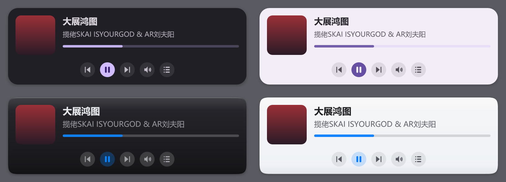
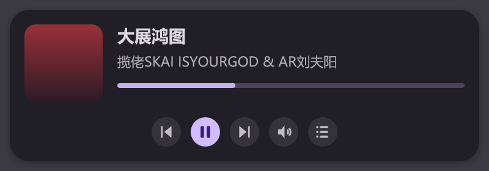
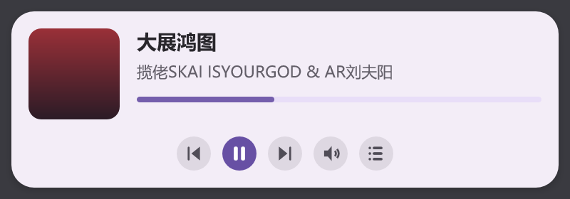
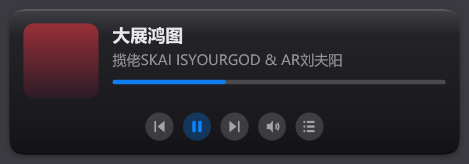
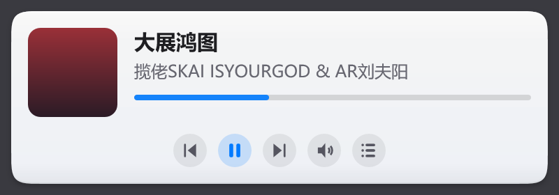
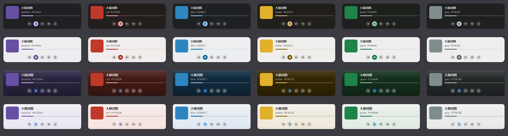
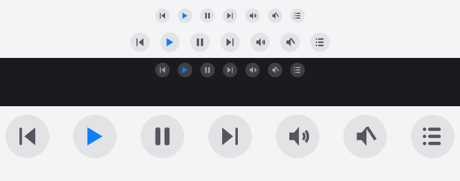

# floating clouds - foobar2000 plugus
**语言**: [ENGLISH](README.md) | **简体中文**
***
Foobar2000 SDK 版本: SDK-2025-03-07
Windows Template Library: WTL10_01_Release
***

一个 foobar2000 组件：在桌面或全屏游戏之上显示悬浮的正在播放窗口，包含封面、标题、艺人与播放控制。



## 组件

本仓库包含三个独立的 foobar2000 组件：

| 组件 | DLL | 作用 |
| --- | --- | --- |
| **Floating Clouds** | `foo_floating_clouds.dll` | 下文所述的悬浮正在播放窗口 |
| **Playlist Organizer** | `foo_playlist_organizer.dll` | 把当前播放列表按专辑艺人拆成锁定的、按 A-Z 排序的艺人列表。[说明](floating_clouds_organizing_playlists/README.md) |
| **Apple Music Tags** | `foo_floating_clouds_tags.dll` | 按地区抓取 Apple Music 标签并写入选中曲目。[说明](floating_clouds_tags/README.md) |

## 特性

- 悬浮窗口：独立的置顶窗口，浮于桌面或全屏游戏之上
- 7 种风格：极简、完整、封面聚焦、进度环、可视化、歌词行、可视化 + 封面
- 2 种材质（皮肤）：**Material 3** 与 **Mist**，各有深色和浅色调色板
- 4 种颜色模式：跟随 foobar2000、强制深色、强制浅色、**封面取色**（主色调取自当前专辑封面）
- 矢量控制图标：整排同一字重、带状态（播放中显示暂停），用路径绘制而不是字体字符，换 UI 字体不会变形
- 字体：跟随 foobar2000 的默认 UI 字体，或在偏好设置的下拉里选任意已安装字体
- 逐像素 alpha：UpdateLayeredWindow 路径（驱动无关，避开 AMD DirectComposition 闪屏）与统一 alpha 回退
- 60fps 平滑动画：进度、淡入淡出、按钮状态层、显隐都是与帧率无关的缓动
- 可自定义全局热键：拖动模式、显隐、切换风格、切换皮肤
- 点击穿透：按钮接收点击，其余区域穿透；拖动模式可移动窗口
- 托盘图标：右键菜单切换风格、皮肤、显隐
- 播放列表选择器：三级面板（播放列表、专辑、曲目）
- 歌词：内嵌 LRC 或纯文本，跟随播放同步
- 实时可视化：平滑后的 FFT 频谱
- 偏好设置页：热键、不透明度、默认风格、皮肤、颜色模式、字体、自动隐藏、界面语言、调试日志

## 快速开始

1. 从 [Releases](https://github.com/Coconutat/floating-clouds---foobar2000-plugus/releases) 下载最新版本
2. 安装 `foo_floating_clouds.fb2k-component`，或把 `foo_floating_clouds.dll` 放进 foobar2000 的 `components` 目录
3. 重启 foobar2000，悬浮窗口会自动出现
4. 默认热键：`Ctrl+Alt+D` 切换拖动模式，`Ctrl+Alt+F` 显隐，`Ctrl+Alt+S` 切换风格，`Ctrl+Alt+T` 切换皮肤

> 热键可在 `文件 > 参数选项 > 组件 > Floating Clouds` 里改：点一下热键框，再按新的组合键
> （必须包含 Ctrl/Alt/Shift/Win）。

## 截图

下面的预览图都是用**组件自己的绘制代码**以 2x 渲染的（同一套 token、圆角几何和图标），
所以它们和真实窗口的几何一致，而不是近似示意图。这些图可复现：在仓库根目录运行
`tools\preview\build_preview.cmd`，再运行 `preview.exe`（不需要 foobar2000 SDK）即可重新生成 `imgs/` 下全部图片。

<table>
  <tr>
    <td align="center"><br/><b>Material 3 · 深色</b></td>
    <td align="center"><br/><b>Material 3 · 浅色</b></td>
  </tr>
  <tr>
    <td align="center"><br/><b>Mist · 深色</b></td>
    <td align="center"><br/><b>Mist · 浅色</b></td>
  </tr>
</table>

**封面取色。** 选 `封面取色` 后整套配色跟着当前封面走：1–2 行是 Material 3 的动态配色，
3–4 行是 Mist（磨砂面板本身被染色），六个封面种子（紫、红、蓝、琥珀、绿、灰）。



**控制图标**，真实尺寸（24px 与 32px 按钮）与放大：



## 风格

| 风格 | 说明 |
| --- | --- |
| 极简 Minimal | 单行：播放标记、标题与艺人、底部细进度条。遮挡最少，适合全屏游戏。 |
| 完整 Full | 小封面、标题/艺人、进度条、控制按钮 |
| 封面聚焦 Album Focus | 大封面作为主视觉，信息与控制在其下方 |
| 进度环 Progress Ring | 缩略图被一圈进度环绕住 |
| 可视化 Visualizer | 实时 FFT 频谱 + 曲目信息，游戏 HUD 风格 |
| 歌词行 Lyrics Line | 当前同步歌词行，游戏中一眼可见 |
| 可视化 + 封面 Visualizer + Cover | 上方封面与曲目信息，下方频谱与波形基线进度线；可选项把进度线贴到波形基线并等宽。 |

上面的预览图展示的是**完整（Full）**风格；所有风格共用同一套材质与颜色系统。

## 材质（皮肤）

| 皮肤 | 说明 |
| --- | --- |
| **Material 3** | 色调表面卡片：surface-container 填充、圆角、投影、MD3 字阶。激活的控制是 filled icon button（`primary` 实底 + `on-primary` 字形），进度条轨道用 `secondary-container`。 |
| **Mist** | 磨砂悬浮面板：近不透明本体 + 浅垂直渐变、1px 内环（顶部亮、底部暗）、顶部高光、连续（squircle）圆角，以及塞进窗口留白里的双层阴影。 |

两者都不自称是「背景模糊玻璃」：分层窗口拿不到背后的像素，所以这里是诚实的磨砂面板，而不是假的模糊。

## 颜色模式

| 模式 | 作用 |
| --- | --- |
| 跟随 foobar2000 | 用 foobar2000 的深/浅色设置（默认） |
| 深色 / 浅色 | 强制外观 |
| **封面取色** | 主色调取自当前专辑封面。Material 3 得到完整动态方案；Mist 得到同样结构、但被染色的面板。深/浅仍跟随 foobar2000——封面只提供色相，不决定明暗。 |

封面取色为什么还能保证可读：封面只提供**色相**，每个角色再被放到 Material 3 规定的 **tone**（固定明度）上，
彩度按黑白两端收缩。于是 `primary`/`on-primary`、`surface`/`on-surface` 这些配对无论封面长什么样都保持对比度；
没有可用色相的封面回落到 MD3 基线紫。六种封面实测：正文 12.7–14.8:1，强调色 5.3–9.9:1，
填充按钮配对 6.1–7.8:1；Mist 染色面板 11.4–12.1:1（深色）与 16.2:1（浅色）。

字体跟随 foobar2000 的默认 UI 字体，或在偏好设置的下拉里选任意已安装字体（第一项是「(跟随 foobar2000)」）。

## 系统要求

- foobar2000 v2.0 或更高（Windows 10 64 位）

## 构建

需要 Visual Studio 2019+（支持 C++17）与 foobar2000 SDK。

foobar2000 SDK **不随仓库提供**。从 <https://www.foobar2000.org/SDK> 下载对应版本（2025-03-07），
解压到仓库根目录的 `SDK/` 文件夹。工程文件引用的是 `..\\SDK\\...` 路径。请按其自身许可使用
（`SDK/sdk-license.txt`）。

根目录的 `build.ps1` 一次构建三个组件，并把打包结果收集到根目录 `dist/`。

给 AI 或调试流程用 `build_agent.ps1`：非交互、顺序构建，直接打印 MSBuild 的错误与警告，没有交互菜单和额外重定向：

```
pwsh -NoProfile -File build_agent.ps1 -Component floating_clouds -Package
```

`build_agent.ps1` 支持：

- `-Component all|floating_clouds|organizing_playlists|tags`（默认 `all`）
- `-Configuration Debug|Release`、`-Platform x64|Win32`
- `-VsInstallDir <路径>`、`-PlatformToolset <工具集>`、`-Package`、`-Clean`、`-MinVersion <版本>`

原来的 `build.ps1` 仍然可用：

```
git clone <repo>
powershell -ExecutionPolicy Bypass -File build.ps1            # 无参数 -> 交互菜单（语言 / 形式 / 组件）
powershell -ExecutionPolicy Bypass -File build.ps1 -Package   # 构建全部三个并打包到根目录 dist\\
powershell -ExecutionPolicy Bypass -File build.ps1 -Language zh -Package   # 中文提示 + 打包
```

常用参数（可组合，便于脚本化 / CI）：

- `-Package` 打包 `.fb2k-component` 并收集到根目录 `dist/`
- `-Deploy -Foobar2000Dir "<foobar2000 根目录>"` 把 DLL 部署进 foobar2000
- `-Component all|floating_clouds|organizing_playlists|tags` 选择组件（默认 all）
- `-Language en|zh` 提示语言（默认 en）
- `-Configuration Debug`、`-Platform Win32`、`-Clean`、`-CleanOnly`、`-Force`
- `-Interactive` 强制进入交互菜单

不带动作参数运行会进入交互菜单（先选提示语言，再选构建形式：仅 DLL / 打包 / 部署 / 清理 / 全部，最后选组件）。
每个组件的构建输出写到 `logs/<组件>-<时间戳>.log`。也可以直接用 Visual Studio 打开
`foo_floating_clouds/foo_floating_clouds.vcxproj`（或其它组件）构建。

## 许可证

详见 [LICENSE](LICENSE)。
